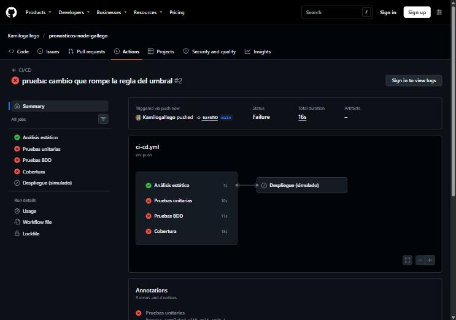
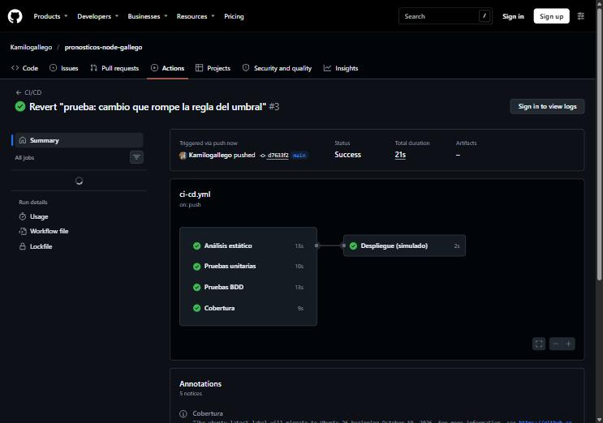

# Informe · Pruebas de la Unidad 2 y pipeline de CI/CD (Node.js)

**Estudiante:** Juan Camilo Gallego Escalante
**Curso:** Pruebas de Software · Ingeniería de Software
**Proyecto:** Pronósticos de demanda (versión Node.js con Express, Jest, jest-cucumber y ESLint)

## 1. Repositorio

https://github.com/Kamilogallego/pronosticos-node-gallego

## 2. Capturas del pipeline

**Pipeline en rojo (Paso 7.5: `>=` cambiado por `>` en `debeGenerarAlerta`)**

Ejecución: https://github.com/Kamilogallego/pronosticos-node-gallego/actions/runs/42951978872 (commit `a544a52`). Fallan *Pruebas unitarias*, *Pruebas BDD* y *Cobertura*; *Análisis estático* pasa y el *Despliegue (simulado)* queda omitido.



**Pipeline en verde (después de `git revert`)**

Ejecución: https://github.com/Kamilogallego/pronosticos-node-gallego/actions/runs/42952121336 (commit `28f999c`). Los cuatro jobs de verificación pasan y el despliegue imprime `Desplegado`.



## 3. Salida de `npm run test:cobertura`

```
----------------|---------|----------|---------|---------|-------------------
File            | % Stmts | % Branch | % Funcs | % Lines | Uncovered Line #s
----------------|---------|----------|---------|---------|-------------------
All files       |     100 |      100 |     100 |     100 |
 pronosticos.js |     100 |      100 |     100 |     100 |
----------------|---------|----------|---------|---------|-------------------

Test Suites: 10 passed, 10 total
Tests:       47 passed, 47 total
Snapshots:   0 total
Ran all test suites.
```

El umbral quedó fijado en `jest.config.js` (`coverageThreshold: { global: { lines: 90, branches: 90 } }`), así que si la cobertura baja de 90 % el comando termina con error y el job *Cobertura* del pipeline falla.

## 4. Respuestas

### ¿Qué vimos en el rojo del Paso 2.1 y por qué es importante verlo antes de escribir el código?

La prueba falló con `TypeError: suavizacionExponencial is not a function`. Eso confirma dos cosas: que la prueba de verdad se ejecuta y que de verdad puede fallar. Si escribo el código primero y la prueba pasa de una, no sé si pasa porque el código está bien o porque la prueba no verifica nada (por ejemplo, porque importé mal la función o el `expect` nunca se evalúa). Ver el rojo primero demuestra que la prueba es capaz de detectar la ausencia del comportamiento, y luego el verde demuestra que el código lo agrega.

En el Paso 2.3 me pasó algo que vale la pena anotar: las pruebas de alfa 0 y alfa 1 pasaron de una, sin verlas en rojo, porque la implementación mínima ya era la fórmula general y la fórmula ya cumple esos dos casos. Las dejé porque documentan los casos límite de la tabla, y el ciclo rojo-verde sí se vio con la validación de alfa fuera de rango (2 pruebas en rojo en el commit `test: prueba en rojo para alfa fuera de rango`, luego verde en `feat: valida que alfa esté entre 0 y 1`).

### ¿Por qué el MAPE del caso `[80, 0, 95]` se divide entre 2?

Porque el segundo periodo tiene demanda real 0 y el error porcentual de ese periodo sería |0 − 0| / 0, una división entre cero que no tiene sentido. La regla del negocio (`mape` en `src/pronosticos.js`) excluye ese periodo, así que solo quedan dos periodos válidos:

- Periodo 1: |80 − 80| / 80 · 100 = 0 %
- Periodo 3: |95 − 100| / 95 · 100 = 5.263 %

MAPE = (0 + 5.263) / 2 = **2.63 %**. Si se dividiera entre 3 daría 1.75 %, que haría ver el pronóstico mejor de lo que es, porque contaría un periodo que no se midió.

### ¿Qué diferencia hay entre una prueba unitaria y un escenario BDD en este proyecto?

La prueba unitaria la escribe y la lee el desarrollador: llama directamente a una función (`debeGenerarAlerta(10, 10)`) y verifica un resultado concreto, incluidos detalles técnicos como el mensaje exacto del error o la tolerancia de decimales. Sirve para saber que cada pieza del código funciona sola.

El escenario BDD describe un comportamiento en lenguaje del negocio (“Dado un umbral de alerta de 10 %, cuando el error del pronóstico es 10 %, entonces se genera una alerta”) para que Producción lo pueda leer y confirmar que esa es la regla que quieren. El archivo `.steps.js` traduce esas frases a llamadas al código. Es decir, la unitaria verifica que el código hace lo que el programador pensó; el BDD verifica que el sistema hace lo que el negocio pidió. En este proyecto las dos usan Jest por debajo, pero el escenario BDD es una prueba funcional (de caja negra, contra el requisito) y la unitaria es de caja blanca, contra una función.

### En el Paso 7.5, ¿qué pruebas fallaron y por qué el despliegue no corrió?

Al cambiar `>=` por `>` en `debeGenerarAlerta` fallaron:

- La prueba unitaria `debeGenerarAlerta › alerta cuando el error es igual al umbral (caso límite)` (job *Pruebas unitarias*).
- El escenario BDD `Alertas de desviación del pronóstico › El error es igual al umbral` (job *Pruebas BDD*).
- Y por eso también falló el job *Cobertura*, porque `npm run test:cobertura` ejecuta todas las pruebas.

Las demás pasaron, porque con 12 % y con 7 % el resultado de `>` y `>=` es el mismo; solo el caso límite (error igual al umbral) detecta el cambio. El despliegue no corrió porque el job `despliegue` tiene `needs: [analisis-estatico, pruebas-unitarias, pruebas-bdd, cobertura]`: GitHub Actions solo lo ejecuta si los cuatro terminan bien, y como al menos uno falló, lo marcó como omitido (*skipped*). Así el cambio que rompía la regla de negocio nunca llegó a “producción”. Después de `git revert HEAD` el pipeline volvió a verde y el despliegue imprimió `Desplegado`.

### Paso 8.1: ¿qué prueba escribimos primero y por qué? ¿Por qué el MSE de la tabla es 143.15 y no 143.22, y cuál debería usar Producción?

La primera prueba fue la del cálculo normal (`calcula el promedio de los errores al cuadrado`, real `[141, 138, 150]` y pronóstico `[126.67, 133.67, 135.67]` → 143.15). La escribí primero porque es el comportamiento principal que pide el requisito: es la que obliga a que la función exista (rojo con `TypeError: mse is not a function`) y a que implemente la fórmula. Las validaciones son reglas secundarias que tienen sentido una vez la función existe. Después escribí las dos validaciones (vistas en rojo antes de agregar `validarSeries`) y tres casos más que consideré necesarios: pronóstico exacto da 0, un error grande pesa más que varios pequeños con el mismo MAD (300 contra 100, que es justo la razón de ser del MSE según el requisito) y que el signo de la diferencia no importa.

Historial (rojo → verde → refactor):

```
b9df637 test: prueba en rojo para mse
40631eb feat: implementa mse
1bf9bde test: pruebas en rojo para las validaciones de mse
0da39b8 feat: valida las series en mse
987e432 test: casos adicionales de mse (exacto, error grande y signo)
fe4e5ab refactor: mejora la legibilidad de mse
```

**143.15 contra 143.22.** La tabla usa los pronósticos ya redondeados a dos decimales (126.67, 133.67, 135.67), y con ellos cada diferencia es 14.33, 4.33 y 14.33: (205.3489 + 18.7489 + 205.3489) / 3 = 143.15. El promedio móvil exacto da 380/3, 401/3 y 407/3 (126.666…, 133.666…, 135.666…), las diferencias son 14.333…, 4.333… y 14.333…, y el MSE da 429.667 / 3 = 143.22. La diferencia aparece porque al elevar al cuadrado, el pequeño error de redondeo también se amplifica.

Producción debería usar **143.22**, calculado con los pronósticos sin redondear: el redondeo es una decisión de presentación y debe hacerse al final, al mostrar el número, no en medio del cálculo, porque cada redondeo intermedio agrega error. La prueba usa 143.15 porque así viene la tabla del requisito y sus entradas ya están redondeadas.

### Paso 8.2: casos nuevos para `promedioMovil` y `mad`

Están en `tests/unit/casosPropios.test.js`. Todos pasaron, así que no encontré defectos en el código actual; quedan como protección para cambios futuros.

| Función | Entrada | Resultado esperado (calculado a mano) | Qué riesgo cubre |
|---|---|---|---|
| `promedioMovil` | serie `[1000, 1, 2, 3]`, ventana 3 | (1 + 2 + 3) / 3 = **2.00** | Que alguien tome los primeros valores (`slice(0, ventana)`) o toda la serie en lugar de los últimos. El 1000 fuera de la ventana haría el resultado muy distinto (334.33 con los primeros 3; 251.5 con toda la serie). |
| `promedioMovil` | serie `[10.5, 11.25, 12.75]`, ventanas 2 y 3 | (11.25 + 12.75) / 2 = **12.00**; (10.5 + 11.25 + 12.75) / 3 = **11.50** | Que se pierdan los decimales de la demanda (por ejemplo, al usar `parseInt`, `Math.floor` o al redondear antes de dividir). |
| `promedioMovil` | serie `[85]`, ventana 1 | 85 / 1 = **85.00** | Que la validación `serie.length < ventana` se cambie por `<=` y se rechace una serie válida de un solo periodo. |
| `mad` | real `[100, 100]`, pronóstico `[110, 90]` | (\|−10\| + \|10\|) / 2 = **10.00** | Que se quite el `Math.abs`: los errores por exceso y por defecto se cancelarían y el MAD daría 0, haciendo ver como perfecto un pronóstico que falla 10 unidades cada periodo. |
| `mad` | real `[50]`, pronóstico `[45]` | \|50 − 45\| / 1 = **5.00** | Que se divida entre `n − 1` en lugar de `n`, o que se exija más de un periodo. Con un solo periodo un error de división daría infinito o un error. |

### Paso 8.3: escenario BDD propio

**Regla elegida:** el error porcentual (MAPE) excluye los periodos con demanda 0 y, si ningún periodo tiene demanda, no se puede calcular. Está en la función `mape` de `src/pronosticos.js` (líneas 41 a 53): el `.filter(({ valorReal }) => valorReal !== 0)` y el `if (erroresPorcentuales.length === 0)` que lanza el error.

Archivos: `tests/bdd/features/mapeDemandaCero.feature` y `tests/bdd/mapeDemandaCero.steps.js`, con dos escenarios: un periodo sin demanda se excluye (80, 0 y 95 contra 80, 0 y 100 → 2.63 %) y sin ningún periodo con demanda se informa que no se puede calcular.

**Por qué es una prueba funcional y no unitaria:** el escenario está escrito desde el punto de vista del planeador de producción, sin nombres de funciones ni variables (“la demanda real de 80, 0 y 95 unidades”, “el error porcentual es 2.63 %”). Verifica el comportamiento del sistema frente al requisito del negocio, como caja negra: a Producción no le importa si por dentro se usa `filter` o un `for`, solo que un mes sin pedidos no deforme la medida. Una prueba unitaria, en cambio, apunta directamente a la función `mape`, conoce su firma y verifica detalles de implementación como el texto exacto del error.

### Paso 8.4: análisis estático configurado

**Regla agregada:** `id-length` con `min: 2` en `eslint.config.mjs`. Exige que los identificadores tengan al menos 2 caracteres, para que los nombres digan qué contienen (pregunta 2 del checklist de revisión).

**Hallazgo provocado a propósito** (en `mse` escribí `const n = erroresCuadrados.length;`):

```
./src/pronosticos.js
  98:9  error  Identifier name 'n' is too short (< 2)  id-length

✖ 1 problem (1 error, 0 warnings)
```

Lo corregí volviendo a usar `erroresCuadrados.length`, que dice qué es.

**Qué encontró en el código existente:**

```
./src/pronosticos.js
  30:49  error  Identifier name 'i' is too short (< 2)  id-length
  45:22  error  Identifier name 'i' is too short (< 2)  id-length
  97:49  error  Identifier name 'i' is too short (< 2)  id-length

./tests/bdd/mapeDemandaCero.steps.js
  43:16  error  Identifier name 'e' is too short (< 2)  id-length

./tests/bdd/promedioMovil.steps.js
  41:16  error  Identifier name 'e' is too short (< 2)  id-length

✖ 5 problems (5 errors, 0 warnings)
```

**Decisión:**

- `i` en los `map((valorReal, i) => ...)`: lo dejé como excepción de la regla (`exceptions: ['i']`). Es la convención universal para el índice de un arreglo y cualquier programador lo entiende; cambiarlo por `indice` en todos lados no mejora la lectura. Preferí ajustar la regla a suprimirla línea por línea, porque es una decisión del equipo, no un caso aislado.
- `e` en los `catch (e)`: lo cambié por `catch (excepcion)`. En los archivos de pasos ya existe una variable `error`, y `e` no deja claro qué contiene.

Al final `npm run lint` no reporta nada y las 47 pruebas siguen pasando.

### Paso 8.5: revisión estática con checklist de `mape`

Función revisada: `mape(real, pronostico)`, líneas 34 a 53 de `src/pronosticos.js`, leída sin ejecutarla.

| # | Pregunta | Respuesta | Evidencia |
|---|---|---|---|
| 1 | ¿El nombre dice qué hace, sin tener que leer el cuerpo? | Sí, a medias | `mape` (línea 41) es la sigla estándar del indicador, clara para alguien de producción o estadística, pero no para alguien nuevo. El JSDoc de la línea 35 la explica. |
| 2 | ¿Los nombres de las variables y los parámetros dicen qué contienen? | Sí | `real`, `pronostico`, `valorReal`, `valorPronosticado`, `erroresPorcentuales` (líneas 41 a 47) son descriptivos. Solo `i` (línea 45) es corto, pero es la convención para un índice. |
| 3 | ¿Tiene una sola responsabilidad? | Sí | Calcula. La validación de las series se delega a `validarSeries` (línea 42); el único `throw` propio (línea 50) es parte de la regla del cálculo. |
| 4 | ¿Repite lógica que ya existe en otro lugar? | **No cumple** | La línea 52 (`sumar(erroresPorcentuales) / erroresPorcentuales.length`) repite el mismo cálculo de promedio que `mad` (línea 31) y `mse` (línea 98). **Hallazgo 2.** |
| 5 | ¿Hay números escritos directamente que deberían tener nombre? | **No cumple** | El `100` de la línea 47 convierte la proporción en porcentaje, sin nombre. El mismo 100 aparece en `debeGenerarAlerta` (línea 61) con otro significado (umbral máximo). **Hallazgo 3.** |
| 6 | ¿Los comentarios explican el porqué y no repiten lo que el código ya dice? | Sí | El JSDoc (líneas 37 a 39) explica *por qué* se excluyen los periodos con demanda 0 (dividiría entre cero) y por qué se lanza un error, cosa que el código solo no dice. |
| 7 | ¿Cada dato inválido produce un error explícito, con un mensaje que dice qué está mal? | **No cumple** | Series de distinta longitud, vacías o todas en 0 sí dan error claro (líneas 42 y 50). Pero una demanda **negativa** no se valida: con real `[-50]` y pronóstico `[-40]` la línea 47 calcula \|−10\| / −50 · 100 = **−20 %**, un error porcentual negativo que no tiene sentido. Tampoco se validan valores no numéricos. **Hallazgo 1.** |
| 8 | ¿Se entiende de una lectura? ¿Cuántas decisiones tiene? | Sí, con esfuerzo en la línea 47 | Tiene 2 decisiones propias (el `filter` de la línea 46 y el `if` de la línea 49), complejidad baja. La cadena `map → filter → map` se entiende, pero la línea 47 mide más de 100 caracteres y hace dos cosas a la vez (diferencia absoluta y conversión a porcentaje). |
| 9 | ¿Cada comportamiento tiene al menos una prueba? ¿Cuál falta? | Casi | Con el Paso 3 ya hay pruebas del cálculo normal, del periodo con demanda 0, de todos en 0 y de las validaciones heredadas. Falta una prueba para la demanda negativa (hoy daría un resultado incorrecto sin avisar) y una con un solo periodo válido. |

**Hallazgos:**

1. **Demanda negativa no validada (línea 47).** Qué: si la demanda real es negativa, el MAPE sale negativo, porque se divide entre `valorReal` y no entre su valor absoluto. Por qué es un problema: un dato mal cargado (una devolución registrada como demanda negativa, por ejemplo) produce un error porcentual sin sentido y, peor, puede *bajar* el promedio y evitar que `debeGenerarAlerta` dispare una alerta que sí debía salir. Propuesta: que Producción decida si una demanda negativa es posible; si no lo es, validar en `validarSeries` con el error “La demanda no puede ser negativa”; si lo es, dividir entre `Math.abs(valorReal)`. Antes de cambiar el código, escribir la prueba que lo proteja.
2. **Lógica de promedio repetida (línea 52, también líneas 31 y 98).** Qué: `sumar(x) / x.length` aparece en `mad`, `mape` y `mse`. Por qué es un problema: si mañana se decide cambiar cómo se promedia (por ejemplo, rechazar arreglos vacíos de forma uniforme), hay que acordarse de cambiarlo en tres lugares. Propuesta: una función auxiliar `promedio(valores)` junto a `sumar`.
3. **Número mágico 100 (línea 47).** Qué: el `* 100` no tiene nombre y el mismo número aparece en `debeGenerarAlerta` con otro significado. Por qué es un problema: quien lea la línea tiene que deducir que es una conversión a porcentaje, y si se busca “100” en el código se mezclan dos conceptos distintos. Propuesta: `const FACTOR_PORCENTAJE = 100;` y, para el umbral, `const UMBRAL_MAXIMO = 100;`.

No cambié el código de `mape`; dejo los hallazgos como propuesta.

**¿Qué encontré que una herramienta de análisis estático no habría encontrado?** El hallazgo 1. ESLint revisa la forma del código (variables sin usar, `==`, complejidad, nombres cortos), pero no sabe qué significa “demanda” ni que un porcentaje de error negativo no tiene sentido en el negocio. Encontrarlo requiere entender el dominio y preguntarse “¿qué pasa si este dato viene raro?”. Lo mismo con la decisión sobre el `i`: la herramienta lo marca, pero la decisión de si es aceptable la toma una persona. Los hallazgos 2 y 3 sí se podrían detectar con reglas (`no-magic-numbers` o un detector de código duplicado), pero no vienen activadas por defecto.

### Si este proyecto fuera una historia de usuario en un sprint, ¿qué pondría en su *Definition of Done* y en qué momento debería participar quien prueba?

**Definition of Done:**

- Los criterios de aceptación de la historia están escritos como escenarios BDD en español, revisados y aprobados por Producción, y pasan.
- Cada función nueva se desarrolló con TDD y tiene pruebas unitarias de su cálculo normal, de sus casos límite y de cada validación, con tolerancia numérica en los decimales.
- `npm run lint` no reporta hallazgos; cualquier supresión está en una sola línea y con su justificación.
- La cobertura de líneas y ramas es de 90 % o más (lo exige el umbral de `jest.config.js`).
- Otra persona del equipo revisó el código (revisión estática con el checklist).
- El pipeline de CI/CD está en verde en `main` y el despliegue se ejecutó.
- La documentación (README, JSDoc) está actualizada con las reglas nuevas.

**Participación de quien prueba:** desde el inicio, no al final. Debe estar en el refinamiento de la historia, junto a Producción y a desarrollo, para convertir los criterios de aceptación en escenarios BDD *antes* de que se escriba el código, y preguntar por los casos límite (¿un error igual al umbral alerta?, ¿qué pasa con una demanda 0 o negativa?). Durante el sprint revisa las pruebas y el código, y al final hace pruebas exploratorias sobre lo que la automatización no cubre. Es la idea de *shift-left*: encontrar los defectos cuando son más baratos de corregir, que es en el requisito.
